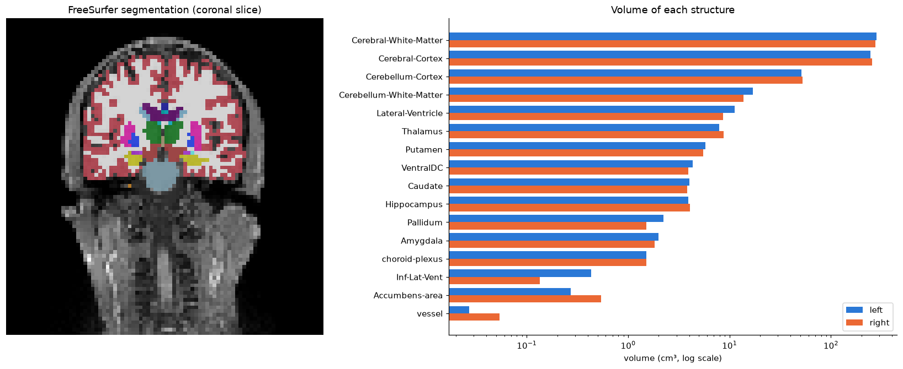

# Segmentation volumes

[](https://github.com/anupbagale/segmentation-volumes/actions/workflows/ci.yml)
[](LICENSE)

Measure the volume of every labelled structure in a 3D segmentation, such as a FreeSurfer brain
segmentation, and put names on the numbers with a lookup table.



## Command-line tool

`label_volumes.py` works with any label image nibabel can read (`.nii`, `.nii.gz`, `.mgz`):

```bash
python label_volumes.py aseg.mgz                                   # print a table
python label_volumes.py aseg.mgz --lut aseg_lut.txt -o volumes.csv # with names, saved as CSV
```

```
voxel size 3 x 3 x 3 mm, one voxel = 27 mm³
label  name                             voxels  volume (mm³)
    2  Left-Cerebral-White-Matter        10477      282879.0
    3  Left-Cerebral-Cortex               9130      246510.0
    4  Left-Lateral-Ventricle              414       11178.0
  ...
total of all non-zero labels: 1308.6 cm³
```

The volume of a label is its number of voxels times the volume of one voxel, taken from the voxel
size in the image header. Labels are counted with `np.bincount` in a single pass over the image.

## Notebook

| Notebook | What it covers | Colab |
|---|---|---|
| [Volume of each label](notebooks/01_label_volumes.ipynb) | voxel size, counting voxels per label, names from a lookup table, totals and checks, left/right comparison, how voxel size changes the result | [open](https://colab.research.google.com/github/anupbagale/segmentation-volumes/blob/main/notebooks/01_label_volumes.ipynb) |

## Data

`data/` holds a FreeSurfer `aseg` segmentation and T1 MRI of the MNE-Python "sample" subject
(CC0), downsampled to 3 mm voxels, and a lookup table with the name of each label. See
[data/README.md](data/README.md). At 3 mm the volumes of small structures are only rough, which the
notebook looks at in detail.

## Running locally

```bash
git clone https://github.com/anupbagale/segmentation-volumes.git
cd segmentation-volumes
pip install -r requirements.txt
```

Tests for the tool and a full run of the notebook:

```bash
pip install pytest nbmake
pytest
pytest --nbmake notebooks/
```

## Related

[segmentation-colormap](https://github.com/anupbagale/segmentation-colormap) colours the same
segmentation with FreeSurfer's lookup table.

## License

Code: [MIT](LICENSE). The MRI data is CC0 (see [data/README.md](data/README.md)).
